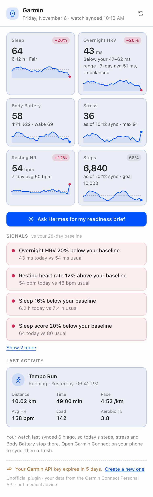
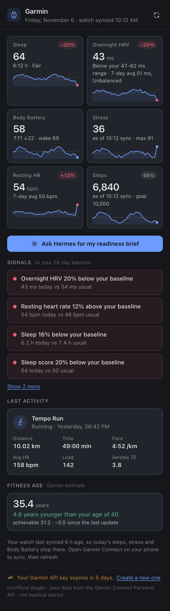
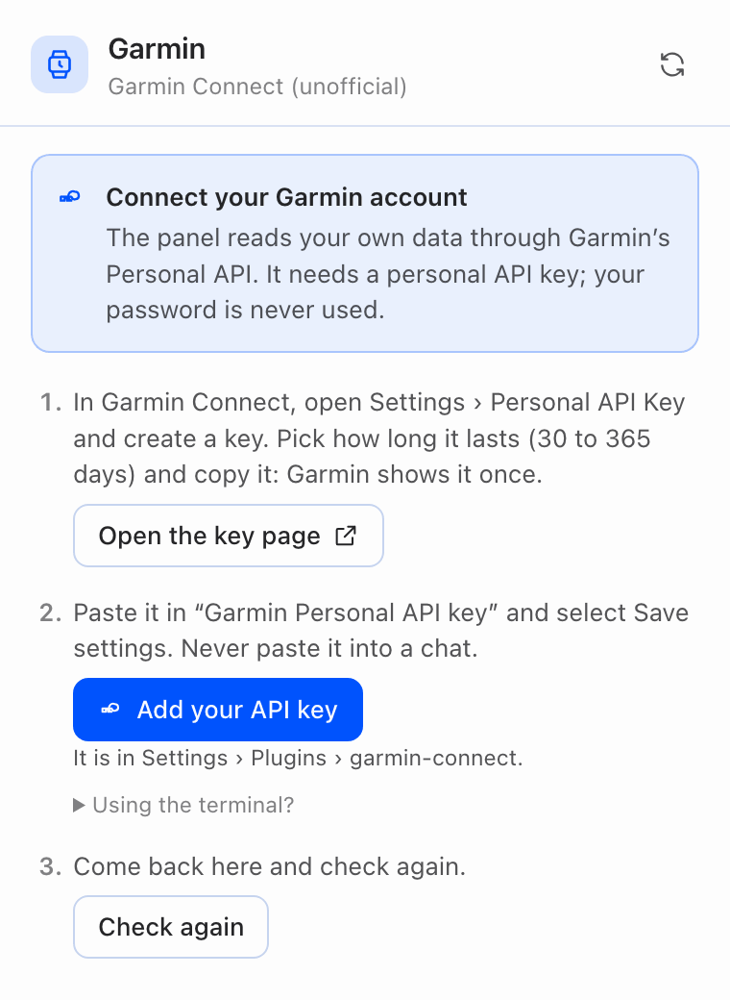
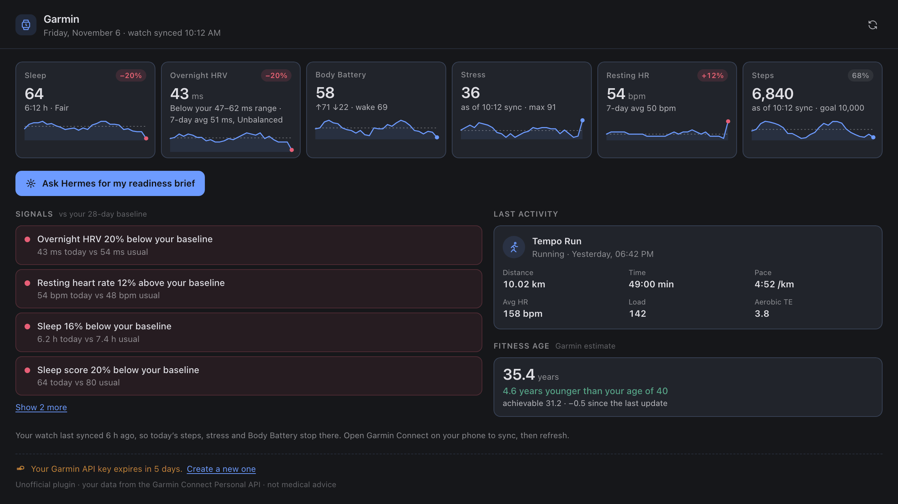

# Garmin Connect for Hermes

Your Garmin data in [Hermes Agent](https://github.com/NousResearch/hermes-agent): sleep, HRV, Body Battery,
stress, steps, heart rate, activities, heart-rate zones, fitness age and weight, read through Garmin's official
[Personal API](https://developer.garmin.com/gc-developer-program/personal/personal-api/). No password, no
scraping, no third-party relay: Hermes talks to Garmin directly with a key you create in Garmin Connect.

On top of the raw numbers it computes your own baselines, so Hermes can say "overnight HRV 18% below your
baseline, resting heart rate up 6 bpm" or "zone 4-5 time 2.1x your 4-week average" instead of guessing from one
night.

> **Unofficial.** This is a community project. It is not affiliated with, endorsed by or supported by Garmin
> or Nous Research. Garmin and Garmin Connect are trademarks of Garmin Ltd. or its subsidiaries.

**Requirements:** Hermes Agent 0.22.2 or later, Python 3.11 or later, a Garmin Connect account with a device
that records the metrics you want. MIT licensed ([LICENSE](LICENSE)). Changes are listed in
[CHANGELOG.md](CHANGELOG.md).



*The Desktop panel. All screenshots in this README are rendered from synthetic test data, not a real account.*

## Quick start

1. **Create a Personal API key.** In Garmin Connect on the web, open
   [Settings > Personal API Key](https://connect.garmin.com/app/settings/personalApiToken), select **Create
   Key**, accept the terms and pick an expiry (30, 90, 180 or 365 days). Copy the key: Garmin shows it once.
2. **Install the plugin and add the key.** No terminal needed in Hermes Desktop; the terminal route follows.

### In Hermes Desktop

1. Open **Capabilities** in the sidebar, then the **Plugins** tab.
2. Install the package:
   - from the catalog: under **Plugin catalog** select **Browse**, find *Garmin Connect* (once it is listed)
     and select **+ Add to this Agent**, then **Install** in the dialog; or
   - from GitHub: select **Install from Git**, paste `https://github.com/adrianlaborda/hermes-garmin` in
     **Repository**, then **Install**.

   Leave **Enable agent plugin after install** checked: Desktop turns on both halves of the package (its
   **Agent** and **Desktop** switches in the **Garmin** row) and the **Garmin** panel opens on the right. A
   toast saying the plugin needs `GARMIN_PERSONAL_API_KEY` is expected: that is the next step.
3. Select **Add your API key** in the Garmin panel. It opens the plugin's own page, **Settings > Plugins >
   garmin-connect** (also reachable with the gear in its row under Capabilities > Plugins). Paste the key in
   **Garmin Personal API key** and select **Save settings**. Desktop stores it in the profile's `.env`,
   never in `config.yaml`, and the field then shows it as set.
4. Back in the panel, select **Check again**. No restart is needed: the panel and the plugin read the key on
   every request. The Garmin tools join the agent within about 30 seconds; start a new chat if one that was
   already open does not see them.

When the key expires, the panel says so and the same button takes you to the field to paste a new one.

### From a terminal

```sh
hermes plugins install adrianlaborda/hermes-garmin
hermes plugins enable garmin-connect
```

The installer asks for `GARMIN_PERSONAL_API_KEY` with a masked prompt and saves it to your profile's `.env`.
To set or replace it later: ` hermes config set GARMIN_PERSONAL_API_KEY <key>` (the leading space keeps it out
of most shells' history).

### Check it

In any chat, `/garmin status` exchanges the key for an access token and shows when it expires. `/garmin today`
prints today's overview.

Never paste the key into a chat message: messages go to your model provider.

Then just ask:

> How did I sleep this week?
> Am I recovered enough for intervals today?
> Compare my last three long runs.
> Has my resting heart rate changed since I started marathon training?

## What Hermes gets

All tools are read-only. Dates are your local calendar days and default to today.

| Tool | What it returns |
|---|---|
| `garmin_today` | One-call overview: last night's sleep and score, overnight HRV and status, Body Battery (now, at wake, high/low), stress, steps vs goal, resting heart rate, latest activity, and when the watch last synced |
| `garmin_sleep` | Per night: duration, stages, score, bedtime and wake time, heart rate, respiration, SpO2. `detail: true` explains one night: each score component (duration, deep/light/REM %, awakenings, restlessness, sleep stress) with Garmin's rating and optimal range, the respiration range, sleep need and naps when present |
| `garmin_hrv` | Overnight HRV (ms), Garmin's HRV status (which rates the 7-day average) and where last night falls against your balanced range. `detail: true` adds one night's curve: 30-minute averages, first vs second half, lowest and highest window |
| `garmin_body_battery` | Charged, drained, high, low and latest (and the events that moved it, when Garmin includes them) |
| `garmin_stress` | Average stress and time in high/medium/low/rest stress |
| `garmin_steps` | Steps, goal and distance, with totals for ranges |
| `garmin_heart_rate` | Resting/min/max, 7-day resting average, optional hourly means |
| `garmin_activities` | Search and list activities by date, type or text; strength workouts include sets, reps and exercises |
| `garmin_activity` | One activity in detail: pace, HR, cadence, power, running dynamics, training effect and load, stamina, splits, and minutes and % in each heart-rate zone with its bpm range |
| `garmin_activity_fit` | Downloads an activity's original file (ZIP with the `.fit`) and returns the local path |
| `garmin_body` | Weight and body composition, water intake |
| `garmin_trends` | Baselines and flags for HRV, resting HR, sleep, sleep score, stress, Body Battery, steps and intensity minutes |
| `garmin_training_load` | Time in heart-rate zones 1-5 over the last N days (7 by default) against your weekly average of the 4 weeks before, easy/moderate/hard shares, time per activity type, intensity minutes vs the weekly goal, and flags |
| `garmin_fitness_age` | Garmin's fitness age vs your age, previous and achievable fitness age, and its inputs (vigorous days and minutes per week, resting HR, BMI or body fat) against Garmin's targets, most effective first |

Responses are compact summaries made for a model to read: units in the field names (`_bpm`, `_km`, `_ms`),
durations as `h:mm`, local times, and no GPS coordinates, profile or social fields. Every data tool takes
`raw: true` when Hermes needs Garmin's full payload.

### Trends

`garmin_trends` fetches up to 120 days (28 by default) and, for each metric, compares the latest value with a
baseline made of the earlier days: mean, standard deviation, z-score and percent change. It also compares the
7-day with the 28-day average. A change is flagged only when it is both large (10% by default) and unusual for
you (|z| of at least 1), and each flag says whether the direction is favourable:

```json
{"metric": "hrv_ms", "kind": "latest_vs_baseline", "verdict": "unfavourable",
 "text": "overnight HRV 18% below baseline (41 ms on 2026-11-06 vs 50 ms, z=-2.4)"}
```

The arithmetic is deterministic and runs in the plugin, so the model interprets numbers instead of estimating
them. Today's running totals (steps, stress, intensity minutes) are compared up to yesterday, so a morning's
low step count never reads as a decline.

### Training intensity

`garmin_training_load` is a separate tool rather than part of `garmin_trends`: trends compares daily recovery
metrics with a per-day baseline, while intensity is a sum over activities in a period, read from another
endpoint (the activity list) with its own baseline. Keeping them apart keeps `garmin_trends` fast and lets the
model call each for its own question.

It sums Garmin's time in heart-rate zones for every activity started in the window and compares it with the
weekly average of the 28 days before (a 14-day window is scaled to a weekly rate). The zone bounds come from your
Garmin heart-rate zone settings (cached for 12 hours). Flags are deterministic:

- zone 4-5 time at least 1.5x or at most 0.5x your 4-week weekly average (that average must be at least
  10 min/week), or at least 20 min/week of zone 4-5 work over a baseline with almost none;
- all time in zones at least 1.3x or at most 0.7x the average (that average must be at least 60 min/week);
- with at least 30 minutes in zones: 90% or more in zones 1-2, 40% or more in zone 3, or 25% or more in zones 4-5;
- for 7-day windows, intensity minutes (moderate + 2 x vigorous, as Garmin counts them) against your weekly goal.

```json
{"kind": "z4_z5_vs_baseline", "direction": "up", "caution": true,
 "text": "Zone 4-5 time 2.1x your 4-week weekly average (32 min this week vs 15 min/week)"}
```

### Daily context (optional)

With `inject_daily_context` on, the first message of each session adds one line such as
`[Garmin status 2026-11-06 ...: slept 7:05 h (score 82); overnight HRV 48 ms, BALANCED; Body Battery 64, 78 at
wake; ...]`, so Hermes knows how you are doing without calling a tool. It runs at most once per session and
day, never waits more than 3 seconds, and is skipped silently on any error.

**Background thread.** To keep the turn from waiting on Garmin, the line is fetched on a short-lived daemon
thread named `garmin-context`, started only when the setting is on, a key is set, and the session has not had
its line yet today. The thread makes the same read-only calls as `garmin_today` (a token exchange when needed,
then the daily summary, sleep, HRV and latest activity, in parallel, with no retries). The turn waits for it at
most 3 seconds; if the thread is slower it keeps running in the background until its requests finish or hit
the 15-second HTTP timeout (about 30 seconds at worst, token exchange included), and its result warms the cache
for the next session. One fetch runs at a time, the line is reused for 30 minutes, and after a failure no
fetch is tried for 10 minutes. With the setting off, no thread is ever started.

The only other background work is the **time zone lookup**. While the `timezone` setting is `auto` (the
default) and a key is set, the first request that needs "today" reads your time zone from your Garmin profile
settings on a short-lived daemon thread named `garmin-zone` (one read-only call, no retries). The request waits
for it at most 2 seconds and otherwise falls back to Hermes' time zone, then the server's. The answer is
reused for 12 hours, and after a failure no lookup is tried for 10 minutes. Picking a zone in the setting
turns the lookup off. The plugin starts no other background process.

It is **off by default** because it sends a summary of your health data to your model provider in every new
session, including ones that have nothing to do with health. Turn it on in Desktop **Settings > Plugins >
garmin-connect > Add today's Garmin status to chats**, or from a terminal:

```sh
hermes config set plugins.entries.garmin-connect.settings.inject_daily_context true
```

### Morning readiness brief

The plugin adds the automation blueprint **Morning readiness brief** (`garmin-connect:morning-readiness`). Schedule it
from `/blueprint`, the dashboard or Desktop's automations: pick a time (leave a few minutes after waking for the
watch to sync), the days, your training context and where to deliver it (Telegram, Discord, email, the chat you
set it up from...). Each run calls `garmin_today` and `garmin_trends` and sends a few lines: sleep, HRV and
resting heart rate against your baseline, Body Battery at wake, flags, and one suggestion for today's training.

### Skill

The bundled `garmin-connect:garmin` skill tells the agent which tool answers which question, how to read HRV, Body
Battery, stress and sleep scores against your own baseline, to check trends before concluding anything, and
when to suggest seeing a doctor instead.

## Hermes Desktop panel

The package also ships a **Garmin** panel for [Hermes Desktop](https://github.com/NousResearch/hermes-agent):
one look at today's readiness next to your chat.

| Dark theme | Before a key is set |
|---|---|
|  |  |



- **Readiness strip:** sleep score and duration, overnight HRV, Body Battery (now, high, low, at wake),
  average stress, resting heart rate and steps against your goal. Each card has a 28-day sparkline with your
  baseline as a dashed line. Sleep, HRV and resting heart rate get a coloured badge for today against that
  baseline (green better, red worse, grey within 5%). Stress, steps and Body Battery are running totals of a day
  that is not over, so they show today's value "so far" without a baseline badge (steps show the % of your goal);
  the Signals compare them on complete days, as `garmin_trends` does.
- **Overnight HRV** shows last night against your balanced range and, separately, Garmin's status, which rates
  the 7-day average: a *Balanced* week can contain a night below the range.
- **Sync time:** the header shows when the watch last synced. When that is more than 2 hours ago, the stress and
  steps cards say "as of HH:MM sync" and a note suggests syncing, so a low step count is not read as inactivity.
- **Signals:** the flags from `garmin_trends`, in plain words ("Overnight HRV 18% below your baseline").
- **Fitness age:** Garmin's fitness age and how far it is from your age, with the achievable fitness age and
  the change since the previous estimate. Hidden when Garmin has none for the account.
- **Last activity:** name and type ("Strength training"), when ("Yesterday, 13:05"), distance, time, pace or speed,
  average heart rate, training load.
- **Ask Hermes for my readiness brief** sends a prompt to the chat that is on screen (or a new one), so the agent
  answers with the tools. Also in the command palette as *Garmin: Ask Hermes for my readiness brief*.
- No key yet, or an expired one: the panel shows the setup steps instead, with an **Add your API key** button that
  opens the plugin's settings page. A key that expires within 7 days is flagged in the footer.

**To see it:** install the plugin from Desktop as in [Quick start](#in-hermes-desktop); Desktop turns on the
panel with the plugin. It is also a full page under **Garmin** in the sidebar and in the command palette
(*Garmin: Open readiness overview*). If the panel says the backend is not reachable, open **Capabilities >
Plugins** and switch on **Agent** in the **Garmin** row: the panel's data comes from the plugin's own backend
routes, which Hermes serves only for enabled plugins. Closing the panel's tab turns the plugin's Desktop half
off; switch **Desktop** back on in the same row. Installed from a terminal, the Desktop half starts off: select
**Rescan** there if Garmin is not listed yet, then switch **Desktop** on.

Developing from a checkout, link it instead of installing: `ln -s ~/src/hermes-garmin ~/.hermes/plugins/garmin-connect`.
Desktop then reloads the panel on every save of `desktop/plugin.js`.

The panel is plain JavaScript (`desktop/plugin.js`, no build step) that imports only the Desktop plugin SDK and
React, uses the Desktop theme colours so it follows light, dark and custom themes, and reads data only through
`/api/plugins/garmin-connect/` (`dashboard/plugin_api.py`). Those routes are read-only, answer with a `state`
(`ok`, `not_configured`, `auth_error`, `rate_limited`, `error`) instead of HTTP errors, and never return the key
or the access token:

| Route | Returns |
|---|---|
| `GET /overview?days=28` | everything the panel shows: cards with sparklines, signals, last activity, key status. `fresh=true` skips the 5-minute cache (the refresh button) |
| `GET /today` | the same overview as `garmin_today` |
| `GET /trends?days=28` | baselines, flags and signals as in `garmin_trends`, plus the daily series (`series=false` to omit) |
| `GET /series?metric=hrv&days=28` | daily values of one metric: `hrv`, `rhr`, `sleep`, `sleep_score`, `stress`, `body_battery`, `steps`, `intensity` |
| `GET /status` | key configured, key expiry when the key carries one; `check=true` also tries a token exchange |

## Settings

In Desktop **Settings > Plugins > garmin-connect**, or under `plugins.entries.garmin-connect.settings` in
`config.yaml`:

| Setting | Default | |
|---|---|---|
| `api_key` | | The Garmin Personal API key. A masked field in Desktop, stored in the profile's `.env` as `GARMIN_PERSONAL_API_KEY`, never in `config.yaml` |
| `region` | `global` | `china` uses `personal.connectapi.garmin.cn` for Garmin China accounts |
| `timezone` | `auto` | Which day is "today". A dropdown: `auto` uses the time zone in your Garmin profile, then Hermes' `timezone`, then the server's; or pick an IANA zone such as `Europe/Madrid`. `/garmin status` shows the zone in use and where it came from |
| `inject_daily_context` | `false` | See [Daily context](#daily-context-optional) |

## Privacy, security and limits

**Where your data goes.** Garmin's servers send your data to your Hermes; when a tool runs, its result goes to
the model provider you use with Hermes, like anything else in the chat. No telemetry, no analytics, no update
check, no remote fonts or images.

**Network hosts.** The plugin's Python code contacts exactly one host, over HTTPS with `GET` requests (plus the
`POST` that exchanges the key for a token):

- `personal.connectapi.garmin.com`, or `personal.connectapi.garmin.cn` when `region` is `china`.

The Desktop panel makes no network requests of its own: it talks only to your Hermes backend
(`/api/plugins/garmin-connect/`). Its **Open the key page** and **Create a new one** buttons open
`https://connect.garmin.com/app/settings/personalApiToken` in your browser; the plugin never fetches that page.

**Background work.** Only the optional daily context line runs off the turn, on a short-lived thread (see
[Daily context](#daily-context-optional)). Nothing runs on a schedule unless you schedule the Morning readiness
brief yourself.

**Read-only.** Garmin's Personal API data endpoints are all `GET`, and the plugin uses nothing else; the one
`POST` is the token exchange, which changes nothing in your account.

**The key.** It is read through Hermes' secret route (`get_secret`, per profile) on each request and never from
files. The plugin exchanges it for a 24-hour access token that stays in memory and is renewed 5 minutes before
it expires. Neither is logged or written to disk, and error messages are scrubbed of both. A rejected key gives
you the link to create a new one. Delete the key in Garmin Connect at any time to revoke all access.

**What is stored.** Responses are cached in memory for 5 minutes to avoid repeated calls. Files downloaded with
`garmin_activity_fit` are saved in `<HERMES_HOME>/plugin-data/garmin/activity-files/` (50 MB limit per file);
delete them whenever you like.

**Limits.**

- No push: Garmin's Personal API has no webhooks, so data is fetched when asked, after your watch has synced.
- Data is as fresh as the last sync. `garmin_today` and the panel say when that was; today's steps, stress and
  Body Battery stop there.
- History depth and range sizes are not documented by Garmin. What one account saw in November 2026 (observed,
  not guaranteed):
  - **History:** sleep, daily summaries and activities answered for dates 5 years back, HRV 3 years back, and
    the activity list paged back to the account's first activity, several years earlier. How far yours goes depends on when
    you started wearing the watch.
  - **Range per request:** steps and stress 28 days, Body Battery and hydration 31, sleep 32 (35 rejected),
    HRV and daily summaries 366 (400 rejected), weight 1,100 or more. Longer ranges get HTTP 400. The plugin
    splits long ranges into windows of 28 (steps, stress), 31 (sleep, Body Battery, hydration), 120 (HRV, daily
    summaries) and 366 days (weight).
  - **Activities:** pages of 100 worked; the plugin pages 40 at a time because larger pages have been reported
    to fail. Garmin's type filter took parent types (`running`, `fitness_equipment`) and some specific
    ones (`indoor_cycling`) but rejected `strength_training` with HTTP 400; on a 400 the plugin filters the
    newest 400 activities itself.
  - **Body Battery** comes as about 6 points per day, so highest and lowest come from the daily summary; the
    per-event breakdown the spec describes was not returned.
  - **Heart-rate zones:** one `DEFAULT` set (lactate-threshold method, five floors plus the max heart rate; the
    resting heart rate field was empty). Time in zone is only on activity-list items (`hrTimeInZone_1..5`,
    seconds), not in the activity detail, so `garmin_activity` makes one extra list request for that day. The
    five zones covered 70 to 97% of a strength session's duration; the rest (below zone 1 or no reading) is
    reported as `outside_zones_min`. Bounds are your current settings; Garmin timed older activities with the
    zones in effect then.
  - **Fitness age** came back as a single object, not the array the spec documents, with four components
    (`vigorousDaysAvg`, `vigorousMinutesAvg`, `rhr`, `bmi`). Garmin's `potentialAge` for the vigorous
    components was above the current fitness age even though they were below target, so the plugin only shows
    a "fitness age at target" when it is lower than the current one.
  - **One night:** `/sleep-service/sleep/dailySleep` returned the same fields as the range endpoint, with no stage
    timeline (no `sleepLevels`, also with extra parameters), so stage segments, time to deep sleep and the
    length of each awakening are not available; sleep need, alignment, sleep heart rate and SpO2 were empty for
    that watch. `/hrv-service/hrv/{date}` sent about 90 readings, one every 5 minutes.
  - Responses took 0.15 to 0.5 s; the token exchange about 1 s; a 15 KB activity file 0.2 s.
- Garmin publishes no rate limit. The plugin retries 429 and 5xx responses with backoff.
- Weight comes in grams (5-digit values for an adult) and is converted to kilograms.
- The Personal API is for **personal use only** (Garmin FAQ): your own data, not a service for other people.
  Read the terms Garmin shows when you create the key. This plugin does not train or fine-tune any model on
  your data; it only passes summaries to the model you chose, when you ask.

**Not medical advice.** Garmin's metrics are estimates from a wrist sensor, and Hermes' reading of them is not
a diagnosis.

## Development

```sh
python -m venv .venv && . .venv/bin/activate
pip install -e '.[test]'
python -m pytest
hermes plugins validate .
```

`hermes plugins validate . --install-deps` (what the catalog CI runs) installs the plugin's dependencies into
the Hermes environment, so run it in a disposable Hermes install, not your daily one. CI
(`.github/workflows/ci.yml`) runs the tests on Python 3.11 and 3.13 and validates the plugin against the
latest stable Hermes release. See [CONTRIBUTING.md](CONTRIBUTING.md) and, for vulnerabilities,
[SECURITY.md](SECURITY.md).

The tests run without network or a Hermes checkout, against fixtures shaped from Garmin's OpenAPI DTOs. With
`HERMES_AGENT_SRC` pointing at a Hermes checkout (and Hermes' interpreter), they also check the automation
blueprint against Hermes' own validator.

Layout: `hermes_garmin/client.py` (token exchange, retries, cache, chunking), `endpoints.py` (Garmin paths and
range limits), `summaries.py` (raw DTO to compact dict), `trends.py` (baseline math), `training.py` (heart-rate zones,
intensity distribution and fitness age), `reports.py` (multi-call
overview and trends), and the Hermes surfaces in `tools.py`, `context.py` and `commands.py`. `panel.py` builds the
Desktop panel's payloads from the same reports; `dashboard/plugin_api.py` serves them and `desktop/plugin.js`
draws them. Install `fastapi` in the test environment to also run the routes over HTTP.

## License

[MIT](LICENSE). Endpoint behaviour was learned from Garmin's
[connect-personal-api-python](https://github.com/garmin/connect-personal-api-python) (Apache-2.0); no code from it
is included.
